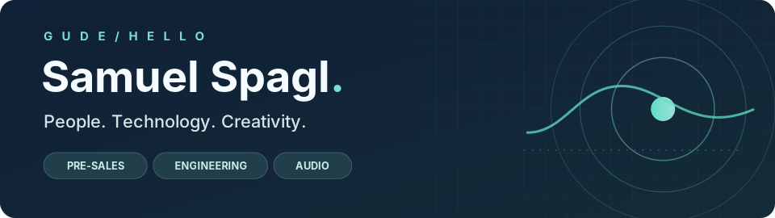

<!-- VERSION 02 · MINIMAL LIGHT HERO + THREE FOCUS BADGES
     Keep the banner uncluttered and put detailed project information below.
     IMPORTANT: Upload assets/hero.png along with this README. -->

  

## ✦ A little about me

Gude! I'm Samuel — a pre-sales consultant who enjoys getting hands-on with code. I work on web apps, integrations, and small products that solve real problems. My background in **sound engineering, web design, and music production** shapes how I think about both technology and user experience.

## ✦ Featured work

<table>
  <tr>
    <td width="50%" valign="top">
      <h3>💬 <a href="https://github.com/samuelspagl/nextcloud-churchtools-chat">ChurchTools Chat</a></h3>
      
Experimental Nextcloud chat application integrating ChurchTools and Matrix, built around a Vue 3 interface and user-scoped access.

      
<code>Vue 3</code> <code>PHP</code> <code>Matrix</code>

      
<a href="https://github.com/samuelspagl/nextcloud-churchtools-chat">Source &amp; screenshots ↗</a>

    </td>
    <td width="50%" valign="top">
      <h3>🔌 <a href="https://github.com/samuelspagl/nextcloud-api-client">Nextcloud API Client</a></h3>
      
A reusable TypeScript client for Nextcloud's Deck, Notes, Bookmarks and authentication flows.

      
<code>TypeScript</code> <code>REST</code> <code>npm</code>

      
<a href="https://www.npmjs.com/package/@samuelspagl/nc-api-client">View npm package ↗</a>

    </td>
  </tr>
  <tr>
    <td width="50%" valign="top">
      <h3>🔊 <a href="https://github.com/samuelspagl/ha_samsung_soundbar">YASSI / Home Assistant</a></h3>
      
Samsung soundbar integration with media controls, sound modes, and equalizer settings. <em>Archived.</em>

      
<code>Python</code> <code>Home Assistant</code> <code>SmartThings</code>

      
<a href="https://github.com/samuelspagl/ha_samsung_soundbar">Explore the integration ↗</a>

    </td>
    <td width="50%" valign="top">
      <h3>▦ <a href="https://github.com/samuelspagl/qr-code-generator">QR Code Generator</a></h3>
      
Responsive QR code app with styling, batch processing, multilingual support, and multiple export formats.

      
<code>Nuxt 3</code> <code>Vue 3</code> <code>Tailwind</code>

      
<a href="https://github.com/samuelspagl/qr-code-generator">Source &amp; screenshots ↗</a>

    </td>
  </tr>
</table>

## ✦ Toolkit

  
  
  
  
  
  

## ✦ A different perspective

I like working across disciplines: understanding what people need, exploring the technical constraints, and building something intuitive. Alongside software, I have a **BA in Sound and Music Production** and experience with sound engineering and web design.

  
<strong>Have a look around.</strong> Start with my <a href="https://github.com/samuelspagl?tab=repositories">repositories</a> or the <a href="https://github.com/samuelspagl/ct-mcp">ChurchTools MCP Server</a>.

<!-- Before applications: confirm job title; add verified contact/LinkedIn; pin featured projects. -->
